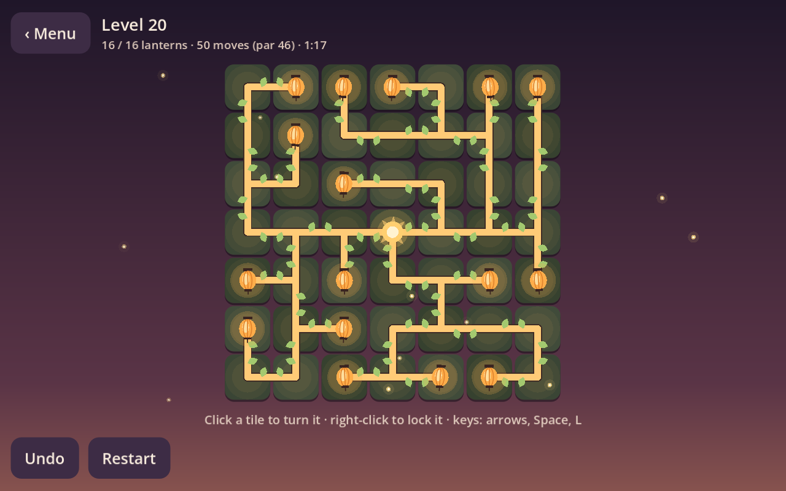

# Glowline



Glowline is a calm garden puzzle at dusk, made with Godot 4. Light flows from the sun in the middle of the board
along the vines. Turn the tiles so every paper lantern glows and no vine ends in the dark.

- **A garden, not a circuit board**: mossy flagstones under a plum and rose sky, vines with leaves that green as the
  light passes, swaying paper lanterns. Light visibly flows out from the sun, tile after tile; a solved board
  sends a ripple of light outward and lets fireflies out. With "reduce motion" set in the system, light shows at
  once and nothing sways or flies.
- **40 levels**, from 3×3 to 9×9, each made by the same seeded generator every time. The first five are short
  teaching boards (3, 4, 5, 8 and 12 moves). Plus a **daily puzzle** (8×8) that changes at midnight, your local
  time.
- **Stars**: par is the fewest moves from the starting board to the generator's answer, counting a turn either
  way as one move (another answer may need fewer). Three stars within par, two within half as many moves again,
  one for any solution.
- **Lock** a tile you are sure of so it cannot turn by mistake: hold it (touch or mouse), right-click it, or press
  L on it. Locking again unlocks it. **Undo** and **restart** any time.
- **Continue** picks up a board you left half done, with its moves, time and undo history.
- **Touch, mouse and keyboard**: tap or click turns a tile clockwise, Shift+click the other way.
  Keys: arrows or WASD move, Space, Enter or E turn (Shift: the other way), Q turns back, L locks,
  U or Ctrl+Z undoes, R restarts, Esc leaves. Menus work with the arrows, Tab and Enter.
- "How to play" opens by itself on the first visit.
- Progress and the sound setting stay in your browser (Godot's `user://`, IndexedDB on the web). No accounts, no
  tracking, no network calls.
- Sounds are made in code (a wooden tok, a wind chime, a kalimba run); there are no image or audio files besides
  the icon.

## Accessibility and the canvas

Godot draws the whole game on one `<canvas>`, so screen readers cannot see its buttons or tiles. The page shell
has a visually hidden live region that the game fills through `JavaScriptBridge`: "Level 4 · 3 of 5 lanterns
lit · 7 moves" after each move, and the result when a board is solved. Everything plays from the keyboard, and the
focused tile has a visible frame. The game scales with the window.

## How it runs on the web

`web/` is the Godot web export, committed: it is the folder that is served (`strux.json`, `"output": "web"`).
It is the **single-threaded** export (`variant/thread_support=false`), so it needs **no SharedArrayBuffer and no
cross-origin isolation headers** (COOP/COEP) and runs on any static host. `project/shell.html` is the page around
the game, with its own loading screen and the live region.

| File | Size |
|---|---|
| `index.wasm` (Godot 4.7.2 engine) | 39.5 MB |
| `index.pck` (the game) | about 50 KB |
| everything else | 0.4 MB |

## Build, test and run

You need [Godot 4.7.2](https://godotengine.org/download) and its export templates (Editor → Manage Export
Templates, or unpack `web_nothreads_release.zip` from the official `.tpz` into the templates folder).

```sh
GODOT=/path/to/godot ./export.sh
```

`export.sh` imports the project, runs the tests, exports into a temporary folder and only then replaces `web/`, so
a failed export leaves the old build in place. It also copies `LICENSE` and `THIRD_PARTY_NOTICES.txt` into `web/`.

Tests alone:

```sh
godot --headless --path project --script res://tests/run_tests.gd
```

`project/tests/run_tests.gd` runs every `test_*` method in `project/tests/test_*.gd` and exits with 1 on a failure.
The tests cover the puzzle rules on hand-made boards, par, the generator, saved progress and stars, and the game
screens (results timing, restart, resume). `test_levels.gd` holds a golden checksum of all 40 levels and one daily
puzzle: if a Godot upgrade or a code change alters the generator, it fails instead of silently changing every level.

To play locally, serve `web/` with any static server (for example `npx serve web`); opening `index.html` as a file
does not work.

There is no linter for GDScript here; the scripts are fully typed and load with no warnings.

## Code map

- `project/scripts/puzzle.gd`: the board: generation (a random tree of pipes from the sun, then turned tiles),
  turning, which tiles the light reaches, when it is solved, and par.
- `project/scripts/levels.gd`: the 40 levels (sizes, seeds, teaching levels), the daily seed (32-bit FNV-1a of
  the date, the same in every Godot version) and the star rule.
- `project/scripts/progress.gd`: saved progress: stars, daily results, settings and the board left half done.
- `project/scripts/board.gd`: the board on screen: input, turning, the light flowing from the sun, the win ripple.
- `project/scripts/garden_painter.gd`: drawing the vines, leaves, sun, paper lanterns and fireflies.
- `project/scripts/backdrop.gd`, `fireflies.gd`: the dusk sky behind every screen, and the drifting fireflies.
- `project/scripts/main.gd`: the menu, the game screen and how a game flows.
- `project/scripts/level_select.gd`, `dialog.gd`: the level list, and the results and how-to-play panel.
- `project/scripts/ui.gd`: colours, the theme and small builders for labels and buttons.
- `project/scripts/stars.gd`, `lock_icon.gd`, `menu_logo.gd`, `sfx.gd`: drawn stars, padlock and logo, and the
  sounds made in code.

`icon.svg` at the root is the listing icon. `project/icon.svg` is the same picture inside the Godot project,
where the engine needs it (the favicon and app icon of the export are made from it).

## Licences

Glowline is MIT licensed, see [LICENSE](LICENSE). © 2026 iSquare Lab.

The web build contains Godot Engine, MIT licensed (© 2014-present Godot Engine contributors, © 2007-2014 Juan
Linietsky, Ariel Manzur), and the third-party code built into it (FreeType, HarfBuzz, zlib and others).
[THIRD_PARTY_NOTICES.txt](THIRD_PARTY_NOTICES.txt) holds their copyright lines and licence texts, taken from the
engine itself; it ships in `web/` too.
